# 💧 DripsLens

<div align="center">

**Real-Time Analytics Engine & Search Platform for the Drips Wave Ecosystem**

[](https://github.com/HassanKorey/DripsLens/actions/workflows/ci.yml)
[](LICENSE)
[](https://www.python.org/)
[](https://fastapi.tiangolo.com/)

**[Documentation Portal](https://HassanKorey.github.io/DripsLens)** •
**[Search Portal](https://dripslens.onrender.com)** •
**[API Docs](https://dripslens.onrender.com/docs)** •
**[Health Check](https://dripslens.onrender.com/health)**

</div>

---

## 📖 Overview

**DripsLens is a real-time analytics engine and search platform that makes the Drips Wave ecosystem trackable, searchable, and verifiable.**

Built with Python 3.12 and FastAPI, DripsLens bridges off-chain developer activities, bounty issues, and on-chain Stellar smart contracts. DripsLens automates Soroban contract event ingestion, monitors repository health and issue bounties across the Drips Wave ecosystem, ranks contributor leaderboards, evaluates compiled WebAssembly (WASM) bytecode health, tracks state storage Time-To-Live (TTL) rent boundaries, maps cross-contract invocation Directed Acyclic Graphs (DAG), and streams real-time contract execution feeds directly to web clients.

---

## 🌐 Live Deployments & Essential Links

- **Documentation Portal**: [https://HassanKorey.github.io/DripsLens](https://HassanKorey.github.io/DripsLens)
- **Search Portal**: [https://dripslens.onrender.com](https://dripslens.onrender.com)
- **Public API Docs (Swagger UI)**: [https://dripslens.onrender.com/docs](https://dripslens.onrender.com/docs)
- **Alternative Docs (ReDoc)**: [https://dripslens.onrender.com/redoc](https://dripslens.onrender.com/redoc)
- **Health Check Endpoint**: [https://dripslens.onrender.com/health](https://dripslens.onrender.com/health)

---

## 🏛 System Architecture

The following diagram illustrates how clients, API endpoints, background schedulers, storage engines, and external blockchain nodes interact within DripsLens:

```mermaid
flowchart TD
    subgraph Clients["Consumers & Web Clients"]
        UI["Web Dashboard (/soroban/explorer)"]
        Consumer["dApps / API Consumers / Bots"]
        SSEClient["Event Stream Consumers"]
    end

    subgraph FastAPILayer["DripsLens FastAPI Core (app/main.py)"]
        RouterHealth["Health Router (/health)"]
        RouterRepos["Repos Router (/repos)"]
        RouterIssues["Issues Router (/issues)"]
        RouterContrib["Contributors Router (/leaderboard)"]
        RouterSoroban["Soroban Router (/soroban)"]
        RouterStream["SSE Stream Router (/soroban/stream)"]
    end

    subgraph Services["Services & Resilience Layer"]
        RedisCache["Redis Cache Layer (app/cache)"]
        WasmAnalyzer["WASM Analyzer (app/soroban/wasm_analyzer)"]
        GraphEngine["DAG Graph Engine (app/soroban/graph)"]
        RPCClient["Soroban RPC Client (httpx + tenacity)"]
        HorizonClient["Stellar Horizon Verifier (app/services)"]
        GitHubClient["GitHub REST Client (app/services)"]
    end

    subgraph BackgroundWorkers["Background Processing (APScheduler)"]
        Scheduler["AsyncIOScheduler (app/scheduler)"]
        EventIndexer["Event Indexer (ingest_soroban_events)"]
        RepoSync["Repo Sync Worker (sync_wave_repositories)"]
    end

    subgraph DataStorage["Data Storage"]
        DB[(PostgreSQL / SQLite via SQLAlchemy 2.0 Async)]
        Alembic["Alembic Schema Migrations"]
    end

    subgraph ExternalEcosystem["External Networks & APIs"]
        SorobanNode["Soroban RPC Node (JSON-RPC 2.0)"]
        HorizonNode["Stellar Horizon REST API"]
        GitHubAPI["GitHub REST API v3"]
    end

    %% Client Interactions
    UI --> FastAPILayer
    Consumer --> FastAPILayer
    SSEClient --> RouterStream

    %% Router to Services
    RouterSoroban --> RedisCache
    RouterSoroban --> WasmAnalyzer
    RouterSoroban --> GraphEngine
    RouterRepos --> DB
    RouterIssues --> DB
    RouterContrib --> DB
    RouterHealth --> DB

    %% Workers & Services
    Scheduler --> EventIndexer
    Scheduler --> RepoSync
    EventIndexer --> RPCClient
    RepoSync --> GitHubClient
    RepoSync --> HorizonClient
    EventIndexer --> DB
    RepoSync --> DB
    Alembic --> DB

    %% External Connections
    RPCClient --> SorobanNode
    HorizonClient --> HorizonNode
    GitHubClient --> GitHubAPI
```



---

## ⚡ Key Features

- **🔮 Soroban RPC Event Indexing**: Automated background worker that polls JSON-RPC 2.0 endpoints (`getEvents`) with tenacity exponential backoff and error recovery.
- **🛡️ Fault-Tolerant Rate Limiting**: Exponential backoff retry logic handling HTTP 429 and 503 errors gracefully across Stellar Horizon and GitHub REST APIs.
- **🔬 WASM Bytecode Analyzer & Health Scoring**: Static byte analysis inspecting size thresholds, function exports, and footprint to calculate health scores (0–100).
- **⏳ Contract State Storage & TTL Tracking**: Monitors ledger expiration sequences (`liveUntilLedgerSeq`) and computes remaining live days before instance rent expires.
- **🕸️ Cross-Contract Invocation Graph (DAG)**: Discovers and maps inter-contract calls from event histories, outputting Directed Acyclic Graph topology nodes and edges.
- **📡 Real-Time Live Event Streaming (SSE)**: Built-in Server-Sent Events endpoint powered by `sse-starlette` providing low-latency broadcasts to clients.
- **🗄️ Database & Scheduler Integrity**: Automatic schema migrations cleanly executed via `alembic upgrade head` and connection pre-ping reconnection handling.
- **📊 Interactive Web Explorer**: Modern responsive UI for visualizing tracked repositories, bounties, and indexed contracts.

---

## 🚀 Quickstart

### Prerequisites

- Python 3.12+
- Git
- Redis (optional, in-memory fallback enabled by default)

### Installation

```bash
# Clone the repository
git clone https://github.com/HassanKorey/DripsLens.git
cd DripsLens

# Create and activate virtual environment
python3 -m venv .venv
source .venv/bin/activate

# Install dependencies
pip install --upgrade pip
pip install -r requirements.txt
pip install -r requirements-dev.txt

# Configure environment variables
cp .env.example .env

# Apply database schema migrations
alembic upgrade head

# Start development server
uvicorn app.main:app --reload --port 8000
```

---

## 📡 API Reference Overview

| Endpoint | Method | Description |
| :--- | :--- | :--- |
| `/health` | `GET` | Health status probe, database state, uptime, and scheduler telemetry |
| `/repos` | `GET` | Filtered repository list (`language`, `multiplier`, `skip`, `limit`) |
| `/repos/{id}/health` | `GET` | Detailed repository health score and verification status |
| `/issues` | `GET` | Ecosystem issues filtered by `complexity` (`Trivial`, `Medium`, `High`) and `is_claimed` |
| `/leaderboard` | `GET` | Contributor rankings sorted by points earned and merged pull requests |
| `/soroban/events` | `GET` | Indexed Soroban smart contract events |
| `/soroban/contracts/{id}/metrics` | `GET` | Bytecode size, function exports, and health scoring |
| `/soroban/contracts/{id}/ttl` | `GET` | Live until ledger sequence and remaining active rent days |
| `/soroban/graph` | `GET` | Cross-contract invocation DAG topology (nodes and edges) |
| `/soroban/stream/events` | `GET` | Real-time Server-Sent Events (SSE) contract event stream |

Visit the interactive Swagger docs at [`https://dripslens.onrender.com/docs`](https://dripslens.onrender.com/docs) or the [API Reference Guide](https://HassanKorey.github.io/DripsLens/api-reference/).

---

## 🧪 Testing & Code Quality

DripsLens enforces strict code formatting, typing rules, and a minimum **80% test coverage threshold** verified in CI.

```bash
# Run complete test suite with coverage
pytest --cov=app --cov-fail-under=80

# Fast linting and import sorting with Ruff
ruff check .

# Check formatting
ruff format --check .

# Static type checking with Mypy
mypy app
```

---

## 👥 Maintainers & Governance

| Name | Role | GitHub | Contact |
| :--- | :--- | :--- | :--- |
| Hassan Akorede (EDUN) | Lead Architect | [@HassanKorey](https://github.com/HassanKorey) | Telegram: `@HassanKorey` |
| Co-Maintainer | Data Pipeline Reviewer | [@Otimileyin](https://github.com/Otimileyin) | Discord: `@Tim` |

For triage procedures, approval thresholds, and security disclosure policies, consult [MAINTAINERS.md](MAINTAINERS.md) and [SECURITY.md](SECURITY.md).

---

## 🤝 Contributors

Thank you to all the contributors making the Drips Wave ecosystem verifiable and observable!

<div align="center">

[](https://github.com/HassanKorey/DripsLens/graphs/contributors)

</div>

---

## 📄 License

This project is licensed under the terms of the **MIT License**. See the [LICENSE](LICENSE) file for details.
