# 🏛 System Architecture

DripsLens is engineered as a high-throughput, monorepo analytics platform designed to bridge off-chain repository bounties with on-chain Stellar smart contracts.

---

## High-Level Topology

```mermaid
flowchart TD
    subgraph Clients["Consumers & Web Clients"]
        UI["Web Dashboard (/soroban/explorer)"]
        Consumer["dApps / API Consumers / Bots"]
        SSEClient["Event Stream Consumers"]
    end

    subgraph FastAPILayer["DripsLens FastAPI Core (app/main.py)"]
        RouterHealth["Health Router (/health)"]
        RouterRepos["Repos Router (/repos)"]
        RouterIssues["Issues Router (/issues)"]
        RouterContrib["Contributors Router (/leaderboard)"]
        RouterSoroban["Soroban Router (/soroban)"]
        RouterStream["SSE Stream Router (/soroban/stream)"]
    end

    subgraph Services["Services & Resilience Layer"]
        RedisCache["Redis Cache Layer (app/cache)"]
        WasmAnalyzer["WASM Analyzer (app/soroban/wasm_analyzer)"]
        GraphEngine["DAG Graph Engine (app/soroban/graph)"]
        RPCClient["Soroban RPC Client (httpx + tenacity)"]
        HorizonClient["Stellar Horizon Verifier (app/services)"]
        GitHubClient["GitHub REST Client (app/services)"]
    end

    subgraph BackgroundWorkers["Background Processing (APScheduler)"]
        Scheduler["AsyncIOScheduler (app/scheduler)"]
        EventIndexer["Event Indexer (ingest_soroban_events)"]
        RepoSync["Repo Sync Worker (sync_wave_repositories)"]
    end

    subgraph DataStorage["Data Storage"]
        DB[(PostgreSQL / SQLite via SQLAlchemy 2.0 Async)]
        Alembic["Alembic Schema Migrations"]
    end

    subgraph ExternalEcosystem["External Networks & APIs"]
        SorobanNode["Soroban RPC Node (JSON-RPC 2.0)"]
        HorizonNode["Stellar Horizon REST API"]
        GitHubAPI["GitHub REST API v3"]
    end

    %% Client Interactions
    UI --> FastAPILayer
    Consumer --> FastAPILayer
    SSEClient --> RouterStream

    %% Router to Services
    RouterSoroban --> RedisCache
    RouterSoroban --> WasmAnalyzer
    RouterSoroban --> GraphEngine
    RouterRepos --> DB
    RouterIssues --> DB
    RouterContrib --> DB
    RouterHealth --> DB

    %% Workers & Services
    Scheduler --> EventIndexer
    Scheduler --> RepoSync
    EventIndexer --> RPCClient
    RepoSync --> GitHubClient
    RepoSync --> HorizonClient
    EventIndexer --> DB
    RepoSync --> DB
    Alembic --> DB

    %% External Connections
    RPCClient --> SorobanNode
    HorizonClient --> HorizonNode
    GitHubClient --> GitHubAPI
```

---

## Architectural Pillars

### 1. Unified Asynchronous Lifespan
DripsLens leverages FastAPI's modern `lifespan` context manager (`app/main.py`). Upon server initialization:
1. Schema integrity is verified and automatically updated with `run_database_migrations()` executing `alembic upgrade head`.
2. The asynchronous `APScheduler` instance boots non-blocking background workers.
3. Upon process termination, workers gracefully flush pending operations and shut down cleanly.

### 2. Multi-Engine Storage Layer
The storage tier utilizes **SQLAlchemy 2.0 Async** supporting:
- **PostgreSQL (`asyncpg`)**: Production enterprise deployment on Render.
- **SQLite (`aiosqlite`)**: Local development and hermetic CI testing using in-memory databases (`:memory:`).
- **Driver Translation**: Automatic normalization ensures synchronous Alembic runners connect via standard `psycopg2` or `sqlite3` without conflicting with async connection pools.
- **Pre-Ping & Reconnection**: Connection pools are configured with `pool_pre_ping=True` and `pool_recycle=300` to automatically recover from dropped database sockets without interrupting active HTTP requests or background jobs.

### 3. Fault-Tolerant Resilience
All external I/O bound requests (Stellar Horizon, Soroban RPC, GitHub REST) are governed by exponential backoff retry algorithms built with `tenacity`. HTTP 429 rate limits, secondary abuse detection, and HTTP 503 transient service outages are handled automatically without bubbling unhandled exceptions to background worker threads.
