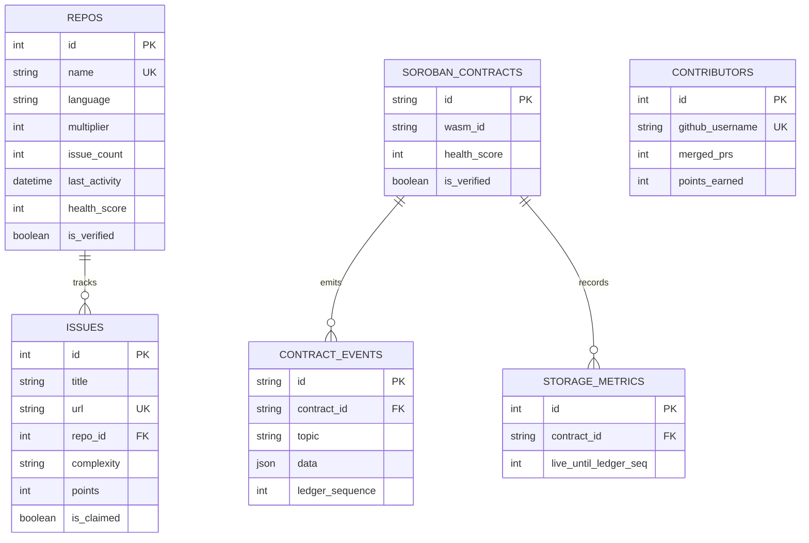

# 🗄️ Data Models

DripsLens models entities using modern **SQLAlchemy 2.0 Declarative Mapping**. Relational schemas are managed via Alembic migrations located in `app/db/migrations/versions/`.

---

## Entity-Relationship Diagram

---

## Model Specifications

### 1. `Repo` (`app/models/repo.py`)
Tracks approved Drips Wave repositories, language stacks, and health scoring.

| Field | Type | Description |
| :--- | :--- | :--- |
| `id` | `Integer` | Primary Key, Indexed |
| `name` | `String` | Unique repository full name (`owner/repo`), Indexed |
| `language` | `String` | Primary programming language (e.g., `Python`, `Rust`), Indexed |
| `multiplier` | `Integer` | Drips Wave bounty multiplier (Default: `1`) |
| `issue_count` | `Integer` | Total number of currently open bounty issues |
| `last_activity` | `DateTime` | Timestamp of latest repository commit or event |
| `health_score` | `Integer` | Computed health metric score from 0 to 100 |
| `is_verified` | `Boolean` | Flag indicating valid Stellar Horizon account association |

---

### 2. `Issue` (`app/models/issue.py`)
Tracks open tasks, complexity tiers, and point values.

| Field | Type | Description |
| :--- | :--- | :--- |
| `id` | `Integer` | Primary Key, Indexed |
| `title` | `String` | Issue title |
| `url` | `String` | Canonical GitHub issue URL, Unique |
| `repo_id` | `Integer` | Foreign Key referencing `repos.id` |
| `complexity` | `String` | Complexity classification: `Trivial`, `Medium`, or `High` |
| `points` | `Integer` | Points awarded: `100` (Trivial), `150` (Medium), `200` (High) |
| `is_claimed` | `Boolean` | True if assignees exist; False otherwise |

---

### 3. `Contributor` (`app/models/contributor.py`)
Tracks developer leaderboard rankings across the ecosystem.

| Field | Type | Description |
| :--- | :--- | :--- |
| `id` | `Integer` | Primary Key, Indexed |
| `github_username` | `String` | Unique GitHub username, Indexed |
| `merged_prs` | `Integer` | Cumulative merged pull requests |
| `points_earned` | `Integer` | Cumulative bounty points accrued |

---

### 4. `SorobanContract` (`app/models/soroban.py`)
Represents an on-chain smart contract deployed to the Stellar network.

| Field | Type | Description |
| :--- | :--- | :--- |
| `id` | `String` | 56-character C... contract public identifier, Primary Key |
| `wasm_id` | `String` | Hexadecimal hash or identifier of compiled WASM bytecode |
| `health_score` | `Integer` | Quality score derived from bytecode analysis (0–100) |
| `is_verified` | `Boolean` | Verification status of contract interface |

---

### 5. `ContractEvent` (`app/models/soroban.py`)
Event logs emitted by smart contracts on the Soroban network.

| Field | Type | Description |
| :--- | :--- | :--- |
| `id` | `String` | Unique event envelope hash / identifier, Primary Key |
| `contract_id` | `String` | Foreign Key referencing `soroban_contracts.id` |
| `topic` | `String` | Event topic string |
| `data` | `JSON` | Structured payload data associated with the event |
| `ledger_sequence`| `Integer` | Ledger sequence number in which the transaction closed |

---

### 6. `StorageMetric` (`app/models/soroban.py`)
Tracks state storage rent and archival limits.

| Field | Type | Description |
| :--- | :--- | :--- |
| `id` | `Integer` | Auto-incrementing Primary Key |
| `contract_id` | `String` | Foreign Key referencing `soroban_contracts.id` |
| `live_until_ledger_seq` | `Integer` | Target ledger sequence after which state archival triggers |
