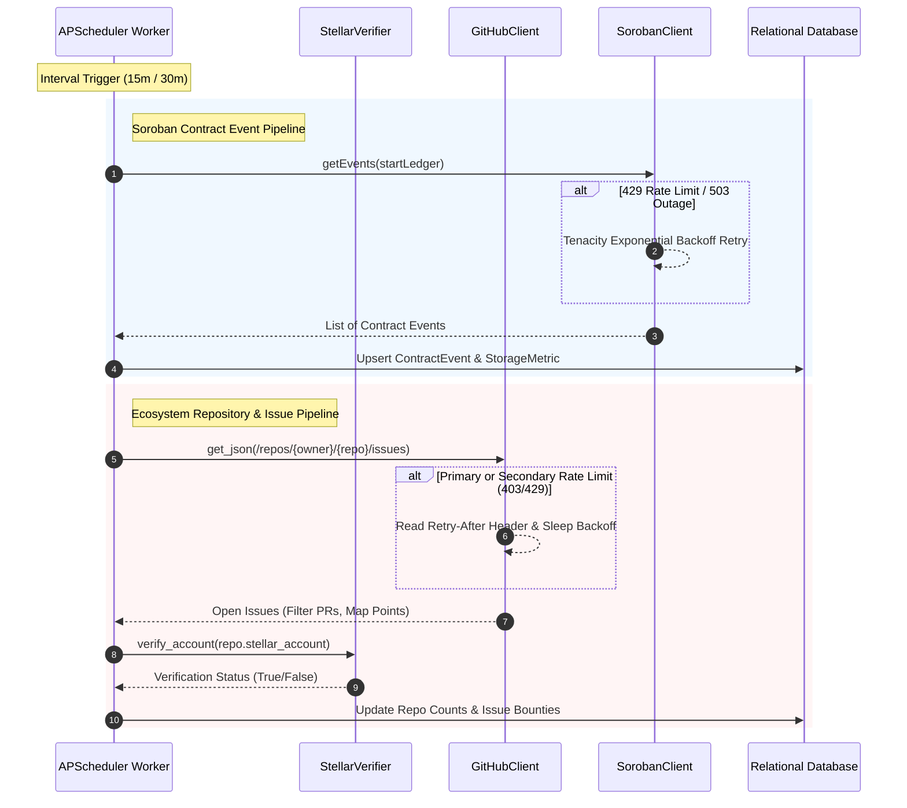

# 🔄 Ingestion Pipeline

The DripsLens Ingestion Pipeline coordinates data collection across on-chain Stellar smart contracts, off-chain GitHub issue bounties, and contributor activity signals.

---

## Ingestion Workflow

---

## Fault Tolerance & Resilience Mechanisms

### 1. Tenacity Exponential Backoff
DripsLens eliminates brittle network polling by encapsulating HTTP requests with `AsyncRetrying`:
- **Initial Wait**: 1 second base backoff with randomized jitter to prevent thundering herd spikes.
- **Maximum Backoff**: 10 seconds upper bound per retry cycle.
- **Retry Count**: 3 attempts before graceful fallback.
- **Monitored Exceptions**: `httpx.ConnectError`, `httpx.ReadTimeout`, `httpx.WriteTimeout`, `StellarHorizonRateLimitError`, `StellarHorizonServiceUnavailableError`, `GitHubRetryableRateLimit`.

### 2. GitHub Rate Limit Detection
GitHub API enforcement separates primary hourly quotas from secondary concurrency limits:
- **Primary Limit (HTTP 403 & `X-RateLimit-Remaining: 0`)**: Detected immediately; logs reset timestamp (`X-RateLimit-Reset`) and raises `GitHubRateLimited` to prevent further wasteful requests.
- **Secondary Limit / 429 (`Retry-After` Header)**: Extracts sleep duration, applies jittered delay, and retries the request safely.
- **Pull Request Filtering**: The `/issues` endpoint inherently returns pull requests. The ingestion parser filters out items containing a `pull_request` key to ensure accurate bounty indexing.

### 3. Horizon RPC & Account Verification
Stellar account validation checks public key strings (`G...` 56 characters) directly against the Horizon `/accounts/{id}` endpoint:
- **HTTP 200**: Account exists; parses native balance and marks repo as verified.
- **HTTP 404**: Account not found on the specified network; flags as unverified without throwing errors.
- **HTTP 429 / 503**: Exponential backoff retry; if exhausted, gracefully falls back to unverified mode rather than stopping scheduler loops.

### 4. Background Job Wrapper
All APScheduler jobs are wrapped with `resilient_job_wrapper` and `execute_with_db_reconnect`:
- Catch transient database socket resets.
- Log error context with execution metadata.
- Prevent unhandled exceptions from terminating APScheduler worker threads.
